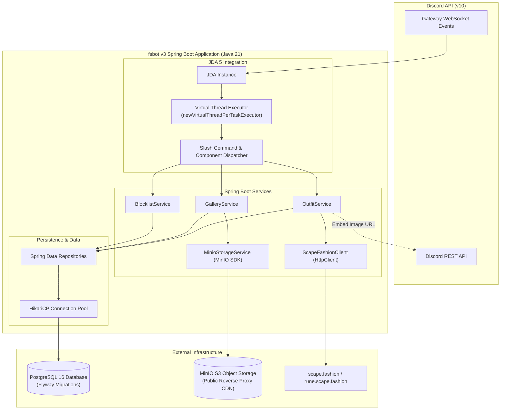
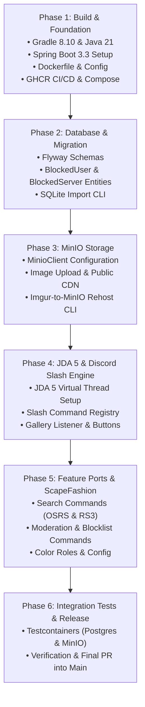

# FashionScape Bot v3 Architecture Specification & Milestone Plan

## 1. Executive Summary & Vision

FashionScape Bot (`fsbot`) v3 is a major architectural overhaul designed to eliminate legacy technical debt, improve scalability and reliability, and modernize the runtime to current enterprise standards.

### Key Tenets
1. **Modern Runtime & Build System:** Java 21 LTS and Gradle 8.10+.
2. **First-Class Application Framework:** Full adoption of Spring Boot 3.3+ for Dependency Injection, Configuration Properties, and Health Actuation.
3. **True Concurrency & Thread-Safety:** Fully non-blocking event loop leveraging Java 21 Virtual Threads (`Executors.newVirtualThreadPerTaskExecutor()`) for JDA events and asynchronous tasks, backed by HikariCP.
4. **Discord Modernization:** Native Discord Slash Commands and UI Components (Buttons, Modals, Select Menus) via JDA 5, deprecating legacy text-prefix commands (`~`).
5. **Robust Relational Storage:** PostgreSQL managed via Flyway migrations and Spring Data JPA, replacing single-threaded SQLite.
6. **Self-Hosted Object Storage:** MinIO S3 integration via the official MinIO Java SDK, replacing external Imgur dependencies, with legacy asset mirroring via a dedicated CLI tool.
7. **Comprehensive Automated Testing:** JUnit 5, Spring Boot Test, and Testcontainers for PostgreSQL and MinIO.

---

## 2. Target Technology Stack

| Component | Current (v2.x) | Target (v3.0) | Justification |
|---|---|---|---|
| **Java Runtime** | Java 16 (`sourceCompatibility = 16`) | **Java 21 LTS** | Virtual threads, pattern matching, records, long-term support. |
| **Build Tool** | Gradle 7.2 | **Gradle 8.10+** | Official Java 21 support and faster configuration cache. |
| **Framework** | Spring Boot 2.5.4 (partially used) | **Spring Boot 3.3+** | Jakarta EE 10, native virtual thread support, configuration binding. |
| **Discord Library** | Javacord 3.8.0 | **JDA 5.x** | Discord API v10, rich interactions, slash commands, components. |
| **Database** | SQLite (raw JDBC, custom connection pool) | **PostgreSQL 16+** | Concurrent access, transactional integrity, JSONB support. |
| **ORM / Data Access** | Custom JDBC queries in `DatabaseProvider` | **Spring Data JPA (Hibernate 6) + HikariCP** | Type-safe entities, repositories, managed connection pooling. |
| **Migrations** | Static SQL string schemas in models | **Flyway 10+** | Versioned, repeatable, and audit-friendly database evolutions. |
| **Media Storage** | Imgur API via OkHttp | **MinIO (S3)** via `io.minio:minio` | Self-hosted, reliable, no third-party rate limits or API key quotas. |
| **Configuration** | Kaaz `ConfigurationBuilder` (`~/.fsbot/bot.config`) | **`application.yml` + `@ConfigurationProperties`** | Standard 12-factor configuration via environment variables and `.env`. |
| **Container Registry & Orchestration** | Local Dockerfile (`docker run`) | **GitHub Container Registry (`ghcr.io`) + Docker Compose** | Automated image builds and publishing on commit/release; turnkey container orchestration. |
| **Testing** | JUnit 4 (empty test suite) | **JUnit 5 + Testcontainers** | Real PostgreSQL & MinIO ephemeral containers for integration tests. |

---

## 3. High-Level System Architecture



---

## 4. Key Subsystem Designs

### 4.1 Discord Interaction & Command Model
- **Command Framework:** Replace the legacy `Guthix` text-prefix parser with a Spring-managed Slash Command Registry.
  - Commands implement an interface (e.g. `SlashCommand`) annotated with `@Component`.
  - On bot ready (`ReadyEvent`), the bot automatically registers global / guild commands with Discord via JDA's `updateCommands()`.
  - Slash command interactions (`SlashCommandInteractionEvent`), button interactions (`ButtonInteractionEvent`), and modal submissions (`ModalInteractionEvent`) route to dedicated handler beans.
- **Interactive UI:**
  - Gallery approval/rating utilizes Discord Buttons (`Button.primary(...)`, `Button.danger(...)`).
  - Search pagination uses next/previous buttons and dropdown select menus (`StringSelectMenu`).

### 4.2 Concurrency & Virtual Threads
- **JDA Event Manager:**
  ```java
  @Bean
  public JDA jda(BotProperties properties, SlashCommandDispatcher dispatcher) {
      ExecutorService virtualExecutor = Executors.newVirtualThreadPerTaskExecutor();
      return JDABuilder.createDefault(properties.getDiscordToken())
          .setEventManager(new InterfacedEventManager())
          .setEventPassthrough(true)
          .setCallbackPool(virtualExecutor)
          .setRateLimitPool(virtualExecutor)
          .setGatewayPool(virtualExecutor)
          .addEventListeners(dispatcher)
          .build();
  }
  ```
- **Spring Async:** Enabled with `spring.threads.virtual.enabled=true` in `application.yml`, allowing `@Async` methods and web calls to execute natively on lightweight virtual threads.

### 4.3 Database Architecture (PostgreSQL & Flyway)
- **Entities:**
  - `OutfitEntity`: ID, S3 key, direct image URL, submitter Discord ID, submitter name, tags, metadata, timestamps, deleted flag, featured flag, display count.
  - `GalleryChannelEntity`: Guild ID, Channel ID, auto-reactions, enabled flag.
  - `ServerConfigEntity`: Guild ID, prefix (if retained for utilities), staff role ID, logging channel IDs.
  - `BlockedUserEntity`: User Discord ID, reason, creator Discord ID, timestamp created.
  - `BlockedServerEntity`: Guild ID, reason, creator Discord ID, timestamp created.
- **Migration Strategy:**
  - `V1__init_schema.sql` establishes tables with PostgreSQL types (`BIGINT` for Discord IDs, `TIMESTAMPTZ`, `VARCHAR`, `BOOLEAN`).
  - A standalone CLI tool / runner `SqliteToPostgresMigrator` reads existing `fsbot.db` records and inserts them into PostgreSQL via Spring Data repositories.

### 4.4 Object Storage Architecture (MinIO)
- **MinIO Service:**
  - Ingests image attachments directly from Discord CDN.
  - Uploads to MinIO using `io.minio.MinioClient`.
  - Emits public CDN/reverse-proxy URLs (e.g. `https://media.fashionscape.org/outfits/{id}.png`).
- **Legacy Image Re-Hoster CLI Tool:**
  - A dedicated run-once CLI runner `ImgurToMinioRehostCli` queries outfits with Imgur URLs (`i.imgur.com/*`), downloads the asset, re-uploads to MinIO, and updates the `link` column in PostgreSQL, offering progress logging and error recovery.

### 4.5 Configuration Management
Replace `~/.fsbot/bot.config` with `application.yml` and `@ConfigurationProperties`:
```yaml
fsbot:
  discord:
    token: ${FSBOT_DISCORD_TOKEN}
    owner-id: ${FSBOT_OWNER_ID}
    guild-id: ${FSBOT_DEV_GUILD_ID:} # Optional for fast command dev registration
  minio:
    endpoint: ${MINIO_ENDPOINT:http://localhost:9000}
    access-key: ${MINIO_ACCESS_KEY}
    secret-key: ${MINIO_SECRET_KEY}
    bucket: ${MINIO_BUCKET:fashionscape-outfits}
    public-url: ${MINIO_PUBLIC_URL:https://media.fashionscape.org}
spring:
  threads:
    virtual:
      enabled: true
  datasource:
    url: ${SPRING_DATASOURCE_URL:jdbc:postgresql://localhost:5432/fashionscape}
    username: ${SPRING_DATASOURCE_USERNAME:fsbot}
    password: ${SPRING_DATASOURCE_PASSWORD:fsbot}
  jpa:
    hibernate:
      ddl-auto: validate
  flyway:
    enabled: true
```

---

## 5. Branching & Phased Implementation Roadmap

### 5.1 Branching Strategy
- **`v3-modernization`**: The root integration branch for the entire v3 milestone.
- **Feature Branches**: Each implementation phase will branch off `v3-modernization` (e.g., `feature/v3-phase1-build`, `feature/v3-phase2-database`, etc.) and submit PRs back into `v3-modernization`.



### 5.2 Phase Breakdown
#### Phase 1: Build & Base Infrastructure (`feature/v3-phase1-build`)
- Upgrade Gradle wrapper from 7.2 to 8.10.2.
- Upgrade `build.gradle` to Spring Boot 3.3.4, Java 21 toolchain.
- Update Dockerfile to multi-stage Eclipse Temurin JDK 21 build.
- Set up `application.yml` with `@ConfigurationProperties(prefix = "fsbot")`.
- Add `example.env` declaring all required configuration variables and secrets.
- Add GitHub Actions CI/CD to build and publish Docker container images to GitHub Container Registry (`ghcr.io`).
- Add `docker-compose.yml` specification configuring the bot container (using the GHCR image) alongside PostgreSQL and MinIO services.

#### Phase 2: Persistence & SQLite Data Migration (`feature/v3-phase2-database`)
- Add `postgresql`, `flyway-core`, `spring-boot-starter-data-jpa`.
- Write initial Flyway schema `V1__init_schema.sql` (defining `outfits`, `gallery_channels`, `server_configs`, `blocked_users`, and `blocked_servers`).
- Create JPA entities (`BlockedUserEntity`, `BlockedServerEntity`, etc.) and Spring Data repositories.
- Implement `SqliteToPostgresMigrationCli` to safely port existing records.

#### Phase 3: Media Storage Migration (`feature/v3-phase3-minio`)
- Add `io.minio:minio:8.5.10+`.
- Implement `MinioStorageService` with upload, stream, and public URL resolution.
- Implement `ImgurToMinioRehostCli` run-once CLI tool to mirror legacy Imgur assets into MinIO.

#### Phase 4: Discord Interaction & Gateway Refactor (`feature/v3-phase4-jda-interactions`)
- Add `net.dv8tion:JDA:5.1.0`.
- Implement JDA lifecycle bean with Java 21 Virtual Thread pools.
- Build `SlashCommand` interface and `SlashCommandDispatcher`.
- Implement `GalleryEventListener` for image submission with voting buttons.

#### Phase 5: Port Commands & ScapeFashion Integration (`feature/v3-phase5-commands`)
- Port outfit commands (`/outfit random`, `/outfit search`, `/outfit info`, `/outfit delete`).
- Modernize `ScapeFashionClient` using Java 21 `HttpClient` and Jackson/Gson.
- Port OSRS & RS3 color search commands.
- Port staff moderation and blocklist commands (`/block user`, `/block server`).

#### Phase 6: Automated Testing & Final Integration (`feature/v3-phase6-testing`)
- Set up Testcontainers for PostgreSQL and MinIO.
- Write repository integration tests and storage upload tests.
- Verify end-to-end slash command dispatching and virtual thread concurrency.
- Final PR of `v3-modernization` into `main`.
